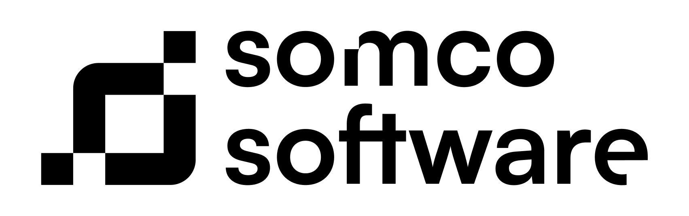

# Lukas Kosiński 👋

CEO of [Somco Software](https://somcosoftware.com) · 3x Qt Champion · Qt Framework 💚 enthusiast

I'm a doer. I like getting things done and shipping, not talking about shipping.

## 🏢 Somco Software

I started out as a Qt developer and kept taking on more and more projects. That led me to found Somco Software, a company that builds embedded and desktop software in Qt and C++, mostly for medical and industrial devices.

These days I don't code much because I'm running the company. I still stay close to the technology and create a lot of content for the Qt community.

**What we do:**

* Embedded software and HMI development (Qt, QML, C++, LVGL, TouchGFX)
* Embedded Linux and Yocto
* Medical device software, including IEC 62304 documentation for MDR and FDA
* Embedded cybersecurity
* Qt and C++ consulting and trainings
* UX/UI design

**Credentials:**

* Official Qt Service Partner, the first company in Poland to hold the title
* ISO 9001:2015 and ISO 13485:2016 certified
* Partners of LVGL, NXP, Renesas, Toradex and SoMLabs

## 🏆 Community

* Named Qt Champion three times
* Speaker at Qt World Summit and other industry events
* Author of articles, YouTube videos and guides on Qt and embedded GUI development

## 📫 Follow me 📮

* [LinkedIn](https://www.linkedin.com/in/lukas-kosinski/)
* [somcosoftware.com](https://somcosoftware.com)

## My top project :chart_with_upwards_trend:

I am the main programmer and maintainer of [SCodes - Qt & Qml wrapper for ZXing library](https://github.com/scytheStudio/SCodes).
This library allows you to easily scan and generate 1D and 2D barcodes in your Qt and Qml applications.

## Top languages

## Contributions to the Qt framework :construction_worker:
I believe that community input is crucial for future of the Qt framework. Therefore I contribute to the Qt repository.
[List of my changes to Qt project](https://codereview.qt-project.org/q/owner:lukasz%2540scythe-studio.com)

In [this blog post](https://somcosoftware.com/en/blog/qt-charts-in-qt-6-2) I've described changes that we (at Somco Software) have done to Qt Charts in Qt 6.2.

<!---
kosadev/kosadev is a ✨ special ✨ repository because its `README.md` (this file) appears on your GitHub profile.
You can click the Preview link to take a look at your changes.
--->
